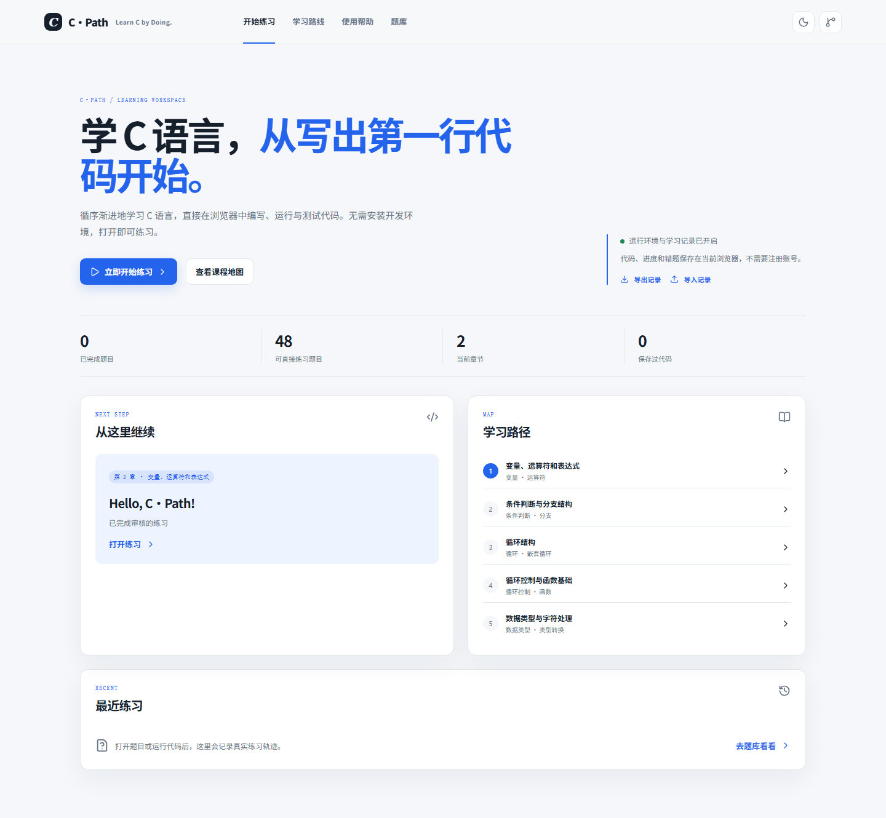
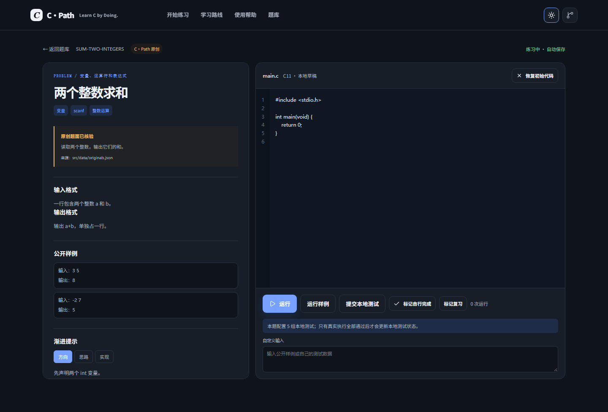
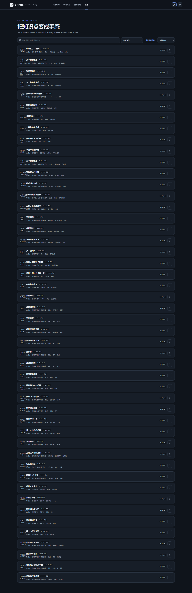
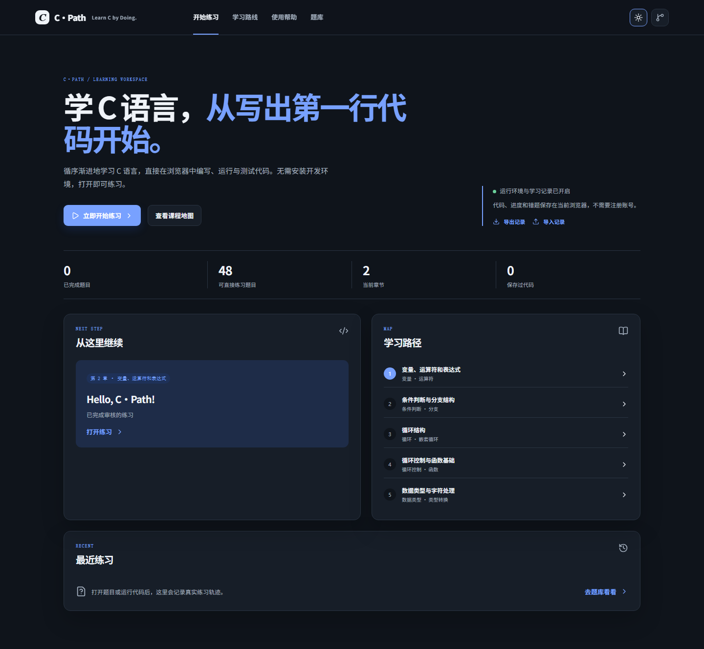
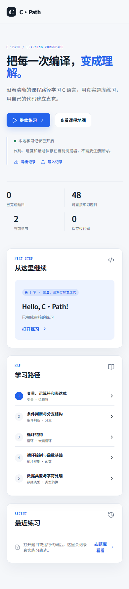

# C·Path

<strong>Learn C by Doing.</strong> A zero-install, browser-first learning workspace for C beginners.

<a href="https://sirizhao.github.io/c-path/">Launch C·Path — Start Coding Online</a> · <a href="README.zh-CN.md">简体中文</a>

  

C·Path helps first-time programmers learn C through explanations, runnable exercises, local tests and browser-local progress. It is independent and is not affiliated with翁恺老师、浙江大学、PAT or any official course platform.

## Start online

1. Open [C·Path online](https://sirizhao.github.io/c-path/).
2. Choose **开始练习** and open **Hello, C·Path!**.
3. Edit main.c, provide stdin when needed, then run the program.
4. Read stdout, stderr or compiler diagnostics.
5. Run samples and submit local tests before moving on.

## Features

- 48 complete C·Path original exercises with statements, constraints, examples, progressive hints, reference solutions and 240 local tests.
- 38 source archive records from the local C_PAT directory, separated from the formal practice set because their original statements and tests are not verified for publication.
- Sandrun/xcc browser C execution in a sandboxed Worker with stdin/stdout/stderr, diagnostics, exit codes, timeouts and output limits.
- Local sample and test comparison with honest execution states.
- Roadmap, topic and difficulty filters, favorites, review markers, recent activity and progress states.
- Local drafts and learning records with export/import.
- Light/dark themes and responsive layouts.

## Learning roadmap

Variables and expressions → conditions → loops → functions → arrays → strings → structures and integrated practice.

The chapter mapping is C·Path navigation, not a claim about official course numbering.

## Practice workflow

The question bank defaults to complete original exercises. Search by title, ID, chapter, difficulty or topic. Open **来源档案** only when you need to inspect a C_PAT record.

The practice page keeps the problem and editor together. Write code, add stdin, run the current program, inspect output, then run samples or local tests. Reference code is behind an explicit disclosure control.

## Architecture

React 19, TypeScript strict mode, Vite, JSON question data with runtime validation, Sandrun/xcc in an iframe and Worker, LocalStorage v2, Vitest, Playwright and GitHub Actions.

The browser runner is for short educational programs. Static hosting cannot provide hidden tests or anti-cheating guarantees. See [THIRD_PARTY_NOTICES.md](THIRD_PARTY_NOTICES.md).

## Local development

    npm ci
    npm run dev
    npm run audit:bank
    npm run audit:formal
    npm run validate:originals
    npm run typecheck
    npm run test
    npm run build
    npm run test:e2e

Windows compiler process restrictions may prevent local GCC validation; Ubuntu Actions is the authoritative GCC evidence.

## Screenshots

| Light | Dark |
| --- | --- |
|  |  |

## Privacy and limitations

Drafts, code and progress stay in the current browser unless exported. Code runs on the visitor device. The first C run may download the runtime. Firefox, WebKit and real mobile Safari/Chrome need additional verification. The editor is intentionally lightweight today and does not yet provide CodeMirror-level language services.

## Contributing

Read [CONTRIBUTING.md](CONTRIBUTING.md) before opening a pull request. Useful contributions include original beginner exercises, independently validated tests, accessibility fixes, documentation and reproducible bug reports. Do not publish third-party statements or solutions without a clear redistribution basis.

## License

Project code is MIT. Question content, source archives and third-party runtime assets retain their own provenance and licenses.
