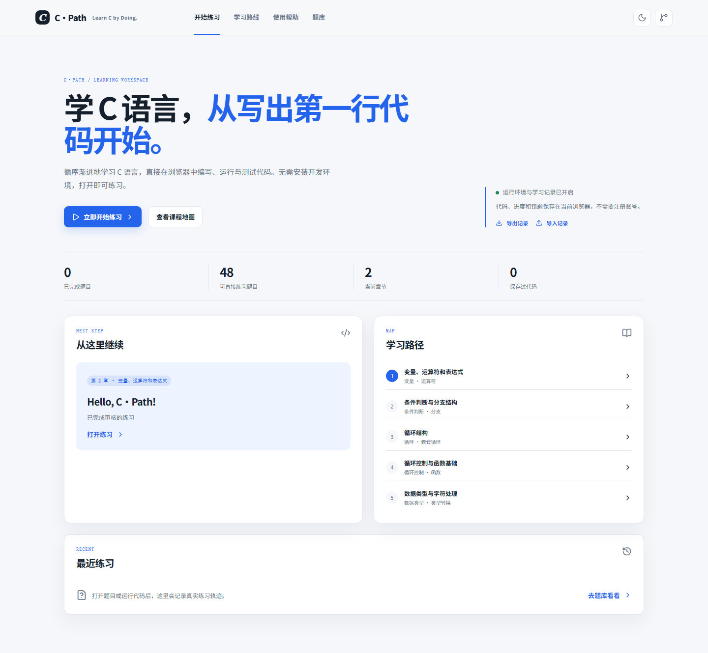
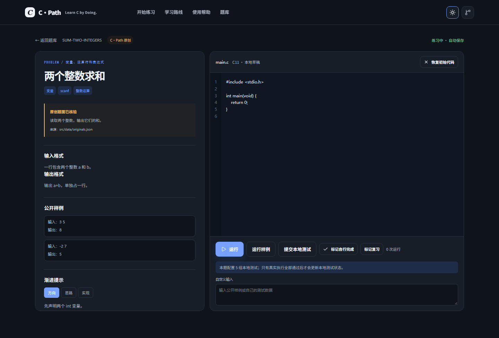
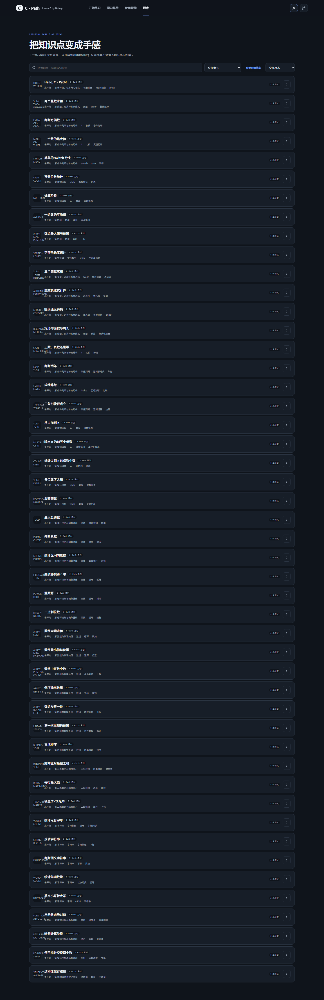
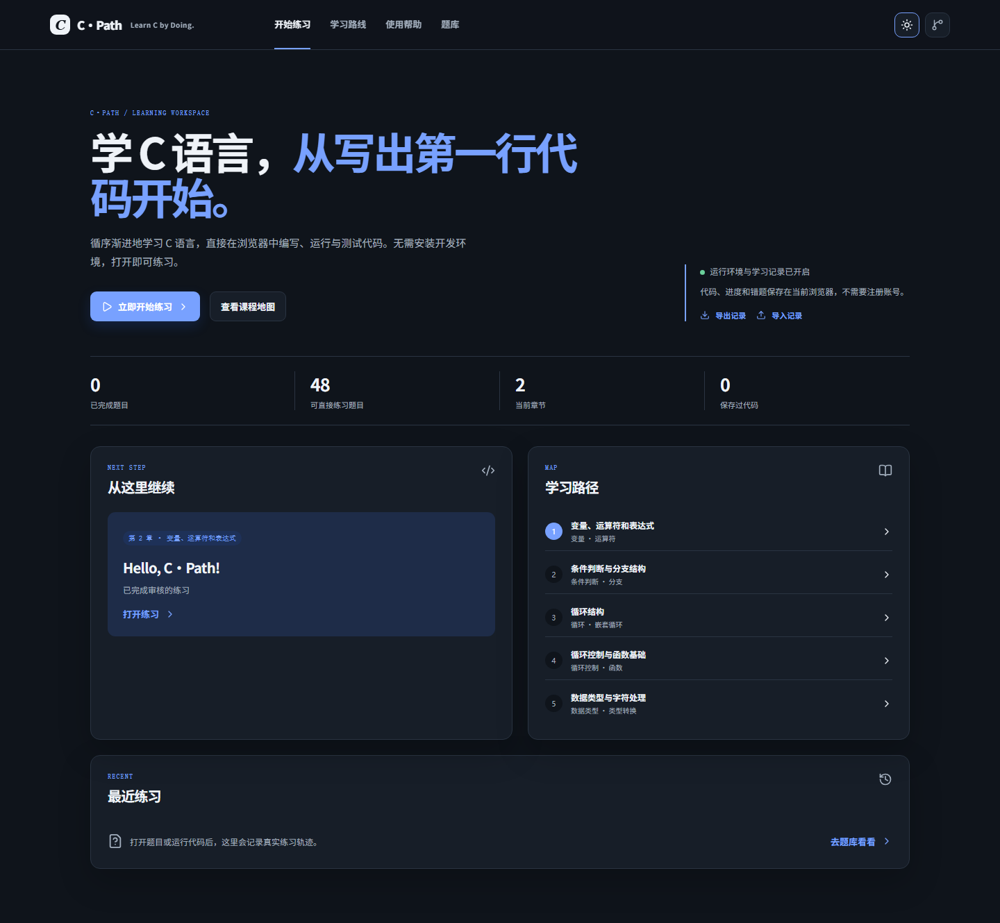
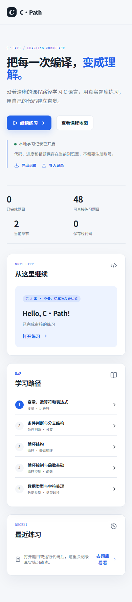

# C·Path

<strong>Learn C by Doing.</strong> 面向 C 语言初学者的零安装、浏览器优先学习与练习工作台。

<a href="https://sirizhao.github.io/c-path/">在线开始学习与练习</a> · <a href="README.md">English</a>

  

C·Path 帮助第一次接触编程的学生，通过讲解、可运行练习、本地测试和浏览器学习记录建立 C 语言直觉。项目独立开源，与翁恺老师、浙江大学、PAT 或任何官方课程平台没有关联。

## 在线开始

1. 打开 [C·Path 在线网站](https://sirizhao.github.io/c-path/)。
2. 选择 **开始练习**，打开 **Hello, C·Path!**。
3. 编辑 main.c，需要时输入 stdin，然后运行程序。
4. 阅读 stdout、stderr 或编译诊断。
5. 运行样例并提交本地测试，再进入下一题。

## 已实现功能

- 48 道完整 C·Path 原创题：题面、约束、样例、分级提示、参考实现和 240 组本地测试。
- 38 条来源档案：来自本地 C_PAT 目录。由于原始题面和测试未完成公开核验，默认不混入正式题库。
- Sandrun/xcc 浏览器 C 运行器：Worker 沙箱、stdin/stdout/stderr、编译诊断、退出码、超时和输出限制。
- 真实运行结果和本地样例/测试比较。
- 学习路线、知识点和难度筛选、收藏、复习标记、最近练习和进度状态。
- 本地草稿与学习记录导出/导入。
- 明暗主题和响应式布局。

## 学习路线

变量与表达式 → 条件判断 → 循环 → 函数 → 数组 → 字符串 → 结构体与综合练习。

这是 C·Path 的学习导航，不代表官方课程原始章节编号。

## 如何练习

题库默认展示完整原创题，可按标题、题号、章节、难度和知识点搜索。需要查看 C_PAT 记录时进入 **来源档案**，来源档案不计入正式学习数量。

练习页面同时展示题面和编辑器。写代码、输入 stdin、运行当前程序、查看输出，再运行样例或本地测试。参考代码通过单独操作展开。

## 技术架构

React 19、TypeScript strict mode、Vite、运行时校验的 JSON 题库、iframe 与 Worker 中的 Sandrun/xcc、LocalStorage v2、Vitest、Playwright 和 GitHub Actions。

运行器面向短小教学程序。静态网站无法提供隐藏测试或防作弊能力。第三方资源见 [THIRD_PARTY_NOTICES.md](THIRD_PARTY_NOTICES.md)。

## 本地开发

    npm ci
    npm run dev
    npm run audit:bank
    npm run audit:formal
    npm run validate:originals
    npm run typecheck
    npm run test
    npm run build
    npm run test:e2e

Windows 本地可能受编译器进程权限限制；Ubuntu Actions 是 GCC 验证依据。

## 截图

| 首页亮色 | 首页暗色 |
| --- | --- |
|  |  |

## 隐私与限制

草稿、代码和进度保存在当前浏览器，除非主动导出。代码在访问者设备上执行。首次运行可能下载工具链。Firefox、WebKit 和真实移动 Safari/Chrome 仍需补充验证。当前编辑器保持轻量，尚未提供 CodeMirror 级别的语言服务。

## 贡献

提交 PR 前请阅读 [CONTRIBUTING.md](CONTRIBUTING.md)。欢迎贡献适合初学者的原创题、独立验证的测试、无障碍修复、文档和可复现问题报告。没有明确发布依据时，不要公开第三方题面或题解。

## 许可证

项目代码采用 MIT License。题目内容、来源档案和第三方运行器资源保留各自的来源与许可。

